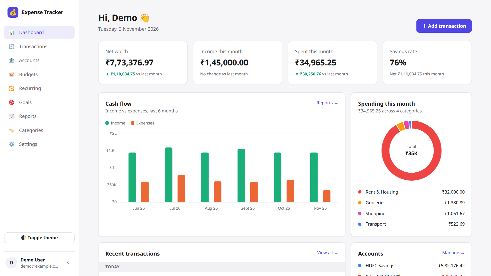
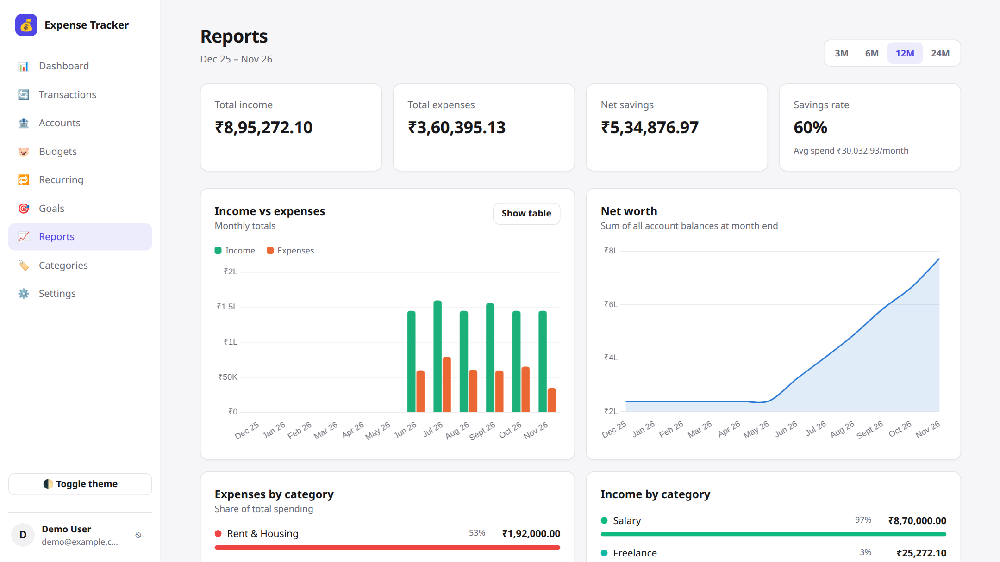
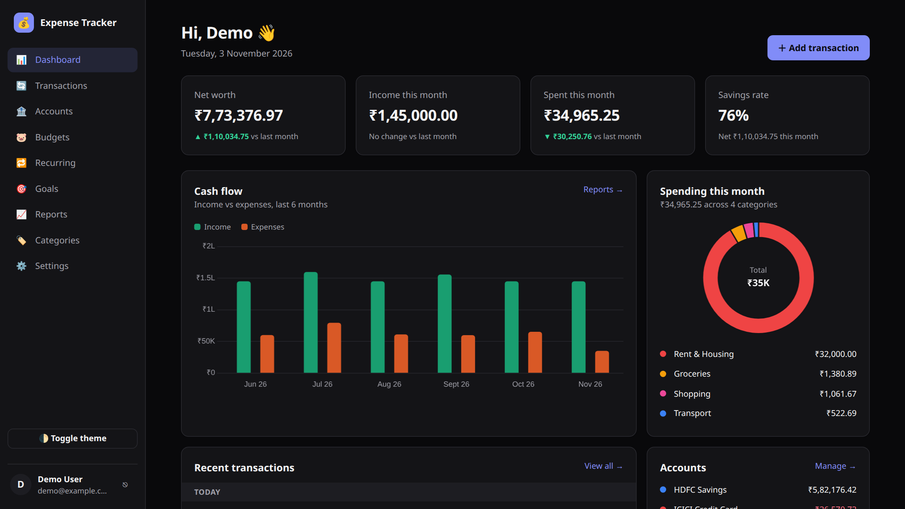
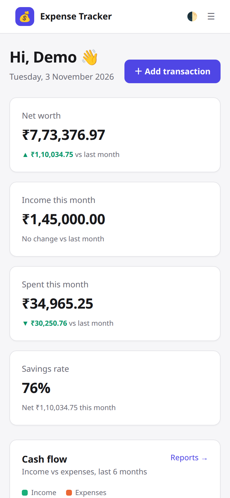

# 💰 Expense Tracker

A full-stack personal finance web app to record income and expenses across multiple accounts, set monthly budgets, automate recurring bills, save towards goals and understand spending through charts.

| Component | Technology |
| --- | --- |
| Frontend | HTML, CSS, JavaScript |
| Framework | React.js (with Vite and React Router) |
| Backend | Node.js |
| Backend framework | Express.js |
| Database | MySQL |
| Charts | Chart.js (via react-chartjs-2) |

The presentation slides are in [`docs/Expense_Tracker_Presentation.pptx`](docs/Expense_Tracker_Presentation.pptx).



| Reports | Dark mode | Mobile |
| --- | --- | --- |
|  |  |  |

## Features

- **Accounts:** bank, credit card, cash, UPI wallet, investment and loan accounts, with live balances and net worth
- **Transactions:** expenses, income and transfers between accounts; search, filters by type/account/category/date, pagination, bulk delete, and CSV export
- **Categories:** income and expense categories with an emoji icon and color; a default set is created at sign-up
- **Budgets:** a monthly limit per category, with a progress bar, a warning when spending runs ahead of the month, and a 3-month average
- **Recurring transactions:** daily, weekly, monthly or yearly items (rent, salary, SIPs) that are recorded automatically when due
- **Savings goals:** a target amount and date, contributions, and the monthly saving needed to reach it on time
- **Dashboard and reports:** KPIs, cash-flow bar chart, spending doughnut, net-worth line chart, category breakdown and top payees (Chart.js)
- **Security:** passwords hashed with bcrypt, JWT authentication, every query scoped to the signed-in user, input validation, parameterized SQL
- Light and dark themes; works on mobile

## Project structure

```
expense_tracker_/
├── backend/                 Node.js + Express REST API
│   ├── db/schema.sql        MySQL tables
│   ├── scripts/             migrate.js (create tables), seed.js (demo data)
│   └── src/
│       ├── server.js        Express app: middleware, routes, serves the built frontend
│       ├── db.js            MySQL connection pool (mysql2)
│       ├── middleware/      JWT auth, error handling
│       ├── routes/          auth, accounts, categories, transactions, budgets, recurring, goals, reports
│       ├── services/        recurring-transaction engine
│       └── utils/           dates, validation helpers, default categories
├── frontend/                React app (Vite)
│   └── src/
│       ├── pages/           Dashboard, Transactions, Accounts, Budgets, Recurring, Goals, Reports, Categories, Settings, Login/Register
│       ├── components/      Layout, forms, modals, Chart.js charts
│       ├── lib/             API client, auth context, formatting
│       └── styles.css       All styling (plain CSS with variables, dark mode)
└── docs/                    Presentation (.pptx)
```

## Run it locally

### 1. Install MySQL (one time)

**Ubuntu / Linux**
```bash
sudo apt update && sudo apt install mysql-server
sudo systemctl start mysql
```
**Windows / macOS:** install MySQL Community Server from https://dev.mysql.com/downloads/mysql/ (or `brew install mysql && brew services start mysql` on macOS).

Then create a database user for the app:
```bash
sudo mysql
```
```sql
CREATE USER 'expense_user'@'localhost' IDENTIFIED BY 'choose-a-password';
GRANT ALL PRIVILEGES ON expense_tracker.* TO 'expense_user'@'localhost';
FLUSH PRIVILEGES;
EXIT;
```

### 2. Configure and start

```bash
npm run install:all                  # installs backend + frontend packages
cp backend/.env.example backend/.env # then edit DB_PASSWORD and JWT_SECRET
npm run db:migrate                   # creates the database and tables
npm run db:seed                      # optional: demo user with 6 months of data
```

Run the API and the website in two terminals:
```bash
npm run dev:api    # http://localhost:5000
npm run dev:web    # http://localhost:5173  ← open this
```

The seed script prints a demo login (`demo@example.com`).

## REST API

All routes except register and login require the header `Authorization: Bearer <token>`.

| Method | Endpoint | Purpose |
| --- | --- | --- |
| POST | `/api/auth/register` | Create an account (returns a token) |
| POST | `/api/auth/login` | Sign in (returns a token) |
| GET | `/api/auth/me` | Current user |
| PUT | `/api/auth/profile` · `/api/auth/password` | Update profile / password |
| DELETE | `/api/auth/account` | Delete the account and all data |
| GET, POST | `/api/accounts` | List with balances / create |
| PUT, DELETE | `/api/accounts/:id` | Update / delete |
| PATCH | `/api/accounts/:id/archive` | Archive or restore |
| GET, POST | `/api/categories` | List / create |
| PUT, DELETE | `/api/categories/:id` | Update / delete |
| GET | `/api/transactions?q=&type=&account=&category=&from=&to=&page=` | Filtered, paginated list with totals |
| POST | `/api/transactions` | Create |
| PUT, DELETE | `/api/transactions/:id` | Update / delete |
| POST | `/api/transactions/bulk-delete` | Delete several |
| GET | `/api/transactions/export` | Download CSV |
| GET, PUT | `/api/budgets?month=YYYY-MM` | Budgets with spending / create or update |
| DELETE | `/api/budgets/:id` | Delete |
| GET, POST | `/api/recurring` | List / create |
| PUT, DELETE | `/api/recurring/:id` | Update / delete |
| PATCH | `/api/recurring/:id/active` | Pause or resume |
| GET, POST | `/api/goals` | List / create |
| PUT, DELETE | `/api/goals/:id` | Update / delete |
| POST | `/api/goals/:id/contribute` | Add or withdraw money |
| GET | `/api/reports/dashboard` | Everything the dashboard needs in one call |
| GET | `/api/reports/summary?months=3\|6\|12\|24` | Report charts data |

## Database design

Eight tables, all linked to `users` with `ON DELETE CASCADE`:

- `users`: login, currency and timezone
- `accounts`: name, type, opening balance (the current balance is calculated from transactions)
- `categories`: income or expense, color, icon
- `transactions`: type (`income` / `expense` / `transfer`), amount, date, account, optional destination account, category
- `budgets`: one monthly limit per category
- `recurring`: schedule (`frequency`, `interval_count`, `next_date`, `end_date`) used to auto-create transactions
- `goals`: target, saved amount, target date

Amounts use `DECIMAL(14,2)` so money never suffers floating-point rounding.

## Deploying to Vercel (+ Aiven MySQL)

Vercel serves the React build as static files and runs the Express API as a serverless function (`api/index.js`, configured in `vercel.json`). Vercel doesn't host MySQL, so use a free hosted MySQL such as Aiven (step 1 below).

1. Create the Aiven MySQL database (step 1 of the next section) and download its CA certificate.
2. In Vercel: **Add New → Project**, import the GitHub repo, and leave the build settings as they are. `vercel.json` sets the install, build and output commands.
3. Before deploying, add the environment variables from the table in the next section. `NODE_ENV` isn't needed; Vercel sets it.
4. Deploy. The build runs `db:migrate` (creates the tables), then builds React. Open the `.vercel.app` URL and sign up.

## Deploying for free (Render + Aiven MySQL)

The Express server also serves the built React app, so you deploy **one web service + one MySQL database**.

1. **Database (Aiven):** sign up at https://aiven.io, create a **MySQL** service on the **Free** plan, and wait until it shows *Running*. From its *Overview* page copy the host, port, user (`avnadmin`), password and database (`defaultdb`), and download the **CA certificate**.
2. **App (Render):** at https://render.com choose **New → Web Service**, connect your GitHub repo, and set:
   - Runtime: **Node**
   - Build command: `npm run build && npm run db:migrate`
   - Start command: `npm start`
   - Instance type: **Free**
3. **Environment variables** (on the same Render page):

   | Key | Value |
   | --- | --- |
   | `DB_HOST` | Aiven host |
   | `DB_PORT` | Aiven port |
   | `DB_USER` | `avnadmin` |
   | `DB_PASSWORD` | Aiven password |
   | `DB_NAME` | `defaultdb` |
   | `DB_SSL` | `true` |
   | `DB_SSL_CA` | the full contents of the downloaded `ca.pem` |
   | `JWT_SECRET` | output of `openssl rand -base64 32` |
   | `NODE_ENV` | `production` |

4. Click **Deploy**. The build creates the tables; when the status shows *Live*, open the `https://<name>.onrender.com` link and sign up.

To load the demo data into the hosted database, run `npm run db:seed` locally with the same `DB_*` values set in your terminal.

Free tiers change, so check each provider's current limits. Render's free web services sleep after inactivity, so the first visit after a while can take up to a minute.
